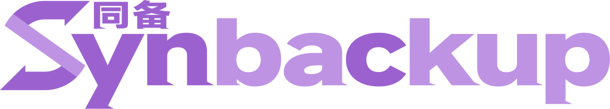

<p align="center">
  
</p>

# 同备 Synbackup

把 U 盘、移动硬盘插上电脑，同备就帮你把指定文件夹同步好——**差异先列出来给你确认，你点头了才动手**。

`1.1.0-beta4` · Windows / macOS · Tauri 2 + Vue 3 + TypeScript + Rust

## 功能特性

- **标题栏自己画**：窗口顶部不用系统自带的那条，改由应用自己绘制（40px 高），整条都能拖动，双击可最大化 / 还原。macOS 保留左上角的红绿灯，Windows 则显示应用自己的最小化、最大化、关闭按钮，鼠标移到关闭上会变红。
- **关掉窗口也不停**：关闭主窗口后界面完全退出，后台程序留在托盘里继续干活——插设备、查差异、发提醒照常进行，点一下托盘图标就能把界面叫回来。
- **自动认设备**：U 盘、移动硬盘、读卡器插上就能识别。平时不反复扫描，由系统通知触发，插上后界面立刻刷新；另有 60 秒一次的兜底检查，防止漏掉。
- **同步任务**：把一个本机文件夹和一台设备上的文件夹配成一对。配对时会在设备上留一个标记文件，靠它认设备，所以**改了卷标、换了盘符依然有效**。
- **差异检查**：拿上次同步的记录做三方比对，分清「本地新增 / 设备新增 / 本地已修改 / 设备已修改 / 两边都改了（冲突）/ 某一侧删了 / 类型冲突」。新建任务时可以选传输方向（本机发送或接收），设备上的文件夹能浏览选择，相对路径由程序自己换算。
- **差异处理**：扫描结果逐条列出，表格里可以看到每项的扩展名类型，各列宽度可在表头拖拽调整（会记住）；可以单条或批量选择「复制到设备 / 复制到本地 / 删除某侧 / 跳过」，确认之后才真正执行。
- **自动同步（可选）**：打开后，没有冲突的差异按建议方向自动执行；**冲突和删除永远等你确认**。开始和结束都会发系统通知，结束时说明同步了多少文件、失败多少。
- **通知**：提醒统一由后台发出，窗口关着也能弹。macOS 用系统较新的通知方式，首次启动会申请权限，应用在前台时也显示横幅，发不出去会把原因告诉界面；Windows 启动时向系统登记自己的身份，通知里显示的就是 Synbackup 的名字和图标，不用再借别的程序名义。设置里的「测试通知」可以自定义标题、内容和**按钮**，点按钮应用里能收到反馈（Linux 桌面通知不支持按钮，只发文字）。
- **同步历史**：每次执行（自动或手动）都记一条，标明是谁触发的，可以展开看每个文件做了什么、成功还是失败、失败原因。单条最多保留 200 项，超出只给数量。
- **多语言与启动**：界面支持 11 种语言，语言选择器里每种语言用母语自称；支持开机自启、插入设备时提醒。
- **总览可定制**：右上角「编辑」能逐项开关统计卡——同步任务 / 已连接设备 / 待处理差异 / 同步项目大小 / CPU 占用 / GPU 占用 / 后端内存占用 / 前端内存占用，关掉的项不再刷新。除任务和差异随事件更新外，其余各项可单独设刷新频率：实时指标 5 / 10 / 15 / 30 / 60 秒，项目大小 1 / 5 / 15 分钟（统计一次要遍历所有本地目录，所以按分钟计）。**CPU 和后端内存说的是常驻后台那部分占多少，前端内存是界面画出来的那部分**（窗口关着时读不到，显示占位符而不是 0），**GPU 是整台电脑的占用**——界面上直接写「系统」，读不到时显示占位符而不是 0；项目大小是各任务本地文件夹的合计，跳过系统垃圾文件和符号链接。
- **外观**：五档主题色和自定义调色板、纸墨 / 终端 / 玻璃三套特殊主题、浅色 / 深色 / 跟随系统、界面字体（三档预设，选「自定义」后才会出现「浏览字体」入口，可以挑系统里的字体）、字体与界面大小按 − / + 微调、任务按钮的显示方式（图标加文字 / 只有图标 / 只有文字）、品牌标志形态（完整字标 / 仅图案 / 自定义文字 / 自定义图片）、六种启动动画（可预览，窗口出现时先出 logo 幕布）。外观偏好即时生效，打开时不会闪一下。
- **更新渠道**：稳定通道对应正式版，测试通道对应预发布版。
- **自动更新**：发现新版本后先给你看版本和更新说明，点「下载更新」才开始下载；按当前系统获取安装包（Windows / macOS 的应用包 zip），显示进度，下载完解压校验，倒计时自动重启安装——读秒可以取消。替换在程序退出后进行（Windows 覆盖同名程序文件、macOS 换掉整个应用包），装好自动打开新版本；正在同步时会拒绝安装，替换失败就退回旧版本，不会把程序弄丢。Windows 升级后程序文件名保持不变。
- **下载来源可选**：GitHub 直连不畅时，设置 → 关于里可以把更新检查与安装包下载切到 gh-proxy 加速链接，还能测一下延迟和速度，看看哪条路快。
- **数据目录可改**：设置 → 关于里可以把配置、同步记录和历史搬到任意可写目录（先试写一次，确认能写再动手，现有数据一并复制过去），重启后生效。自定义位置记在程序旁边的 `location.txt` 里，这个文件失效时自动回到默认位置。

## 界面

界面靠一套规则统一，而不是逐个页面调样式：

- **窗口外观自己做**：应用关掉了系统边框，标题栏由界面绘制。macOS 单独设成「透明标题栏 + 隐藏标题文字」，三个红绿灯仍由系统画，其余部分全归应用。
- **品牌配色**：主题色 `#9B62CF` 用在「实」的地方（主按钮、选中填充、强调文字与图标、焦点框、进度条），辅助色 `#BE93E3` 用在「虚」的地方（浅底、悬停描边、次级图标）。选中和悬停的浅底由辅助色调出来，悬停的实色用深一档 `#8A4FC0`，保证白字始终看得清。颜色集中放在一处，换肤只改这层。
- **标志是矢量的**：logo 直接画在界面里，不读图片文件，怎么缩放都清晰。标题栏放横向的文字标（16px 高），关于页把同一枚标居中放大（32px 高），两处同源同一份设计稿。
- **材质分层**：标题栏和侧栏同属结构层，用同一层半透明材质；内容区用实色。不在浅色材质上再叠一层浅色。
- **交互即时**：按钮悬停、按下都有即时反馈；系统开启「减少动态效果」时只变颜色不移位，开启「减少透明度」时侧栏和标题栏变实色。
- **启动即品牌**：窗口出现时先铺一层底色和居中的 logo，按所选动画入场（淡入 / 上浮 / 缩放 / 滑入 / 虚化 / 弹出），落定后整幕淡出。幕布不挡鼠标，下面的界面已经开始响应；关掉启动动画就完全不会出现。
- **跟随平台习惯**：macOS 红绿灯在左上、logo 在右上；Windows 自绘按钮在右上、悬停变红、logo 在左上。按钮顺序和最大化 / 还原图标跟窗口真实状态保持同步。

已知限制：macOS 的透明标题栏由系统实现，窗口失去焦点时拖不动（上游限制，`tauri-apps/tauri#4316`）。

实现提示：窗口边框在 `src-tauri/tauri.conf.json` 里关闭（`decorations: false`），macOS 由 `src-tauri/tauri.macos.conf.json` 覆写为透明标题栏（`titleBarStyle: Overlay`、`hiddenTitle: true`）；配色与尺寸令牌在 `src/styles/tokens.css`，标题栏与标识组件在 `src/components/`。

## 架构

界面和后台完全分开，各干各的：

```
        界面（Vue 3 + TypeScript）
          │  ↑  调用接口 / 接收事件
          ↓  │
        后台（Rust）：配置 / 设备监控 / 差异扫描 / 执行 / 历史
          │
          └─ 托盘常驻：关掉窗口也继续跑
```

- 所有业务逻辑都在后台（`src-tauri/src/backend/`），不依赖界面框架，可以脱离界面单独工作。
- 关掉主窗口时界面被彻底销毁（Windows 上连网页组件进程一起退出），后台进程和监听循环继续运行。
- 界面不存任何「真相」：配置、清单、待处理差异全在后台，窗口重开后恢复成关之前的样子。

### 同步模型

每个任务维护一份同步清单，记着上次同步时每个文件在两侧的大小和修改时间：

| 状态 | 含义 | 建议操作 |
| --- | --- | --- |
| 本地新增 / 设备新增 | 只在一侧存在 | 复制到另一侧 |
| 本地已修改 / 设备已修改 | 只有一侧比上次同步时变了 | 以改动的那侧为准 |
| 两边都改了 | 双向冲突 | 由你决定（默认跳过） |
| 某一侧删了 | 上次同步后文件被移除 | 默认跳过，绝不自动删 |
| 类型冲突 | 同名的地方一边是文件、一边是文件夹 | 由你决定 |

安全上的几条底线：复制时保留修改时间；自动跳过 `.DS_Store`、`Thumbs.db`、`System Volume Information` 这类系统文件；删除只作用于配对目录内部；配置和清单写入时不会只写一半（中途出错也不会留下损坏文件）。

## 开发

环境要求：Node.js 18 及以上、Rust 1.77 及以上（Windows 还要装 MSVC 和 WebView2，macOS 要装 Xcode 命令行工具）。

```bash
npm install
npm run tauri dev     # 开发运行
npm run tauri build   # 打包（macOS 生成 .app/.dmg，Windows 生成 .msi/.exe）
```

只想校验不运行：

```bash
npm run build         # 类型检查 + 构建
cd src-tauri && cargo check
```

## CI 与发布

发版只有两步：把 `src-tauri/tauri.conf.json` 的版本号改掉、在 `CHANGELOG.md` 补上 `## [版本号]` 段，然后推送到 `main`。

- **Release（自动）** `.github/workflows/release.yml`：推送到 `main` 后按版本号发布。这个版本已经发过就直接跳过（版本没变的日常提交不会重复构建）；是新版本就打 tag、双平台构建并发布——带 `-` 的版本（如 `1.1.0-beta4`）发预发布，纯 `x.x.x` 发正式版并标为最新。手动触发一律当作重发，按 tag 覆盖产物。
- **CI（手动）** `.github/workflows/ci.yml`：Actions → CI → Run workflow，按需构建校验，产物在 Actions 页面的 Artifacts 里下载：

  - `Synbackup_<版本>_windows-x64.zip` — Windows 64 位便携版（解压即得 `Synbackup.exe`，目标电脑需已装 WebView2 运行组件，Win10/11 默认自带）
  - `Synbackup_<版本>_macos-arm64.zip` — macOS Apple 芯片版应用包（解压即得 `Synbackup.app`，未签名，首次打开需右键 → 打开）

产物文件名就是自动更新找包的依据（`Synbackup_<版本>_windows-x64.zip` / `Synbackup_<版本>_macos-arm64.zip`），改名会让更新直接失效。压缩包名带版本号便于手动下载时分辨，包内文件名固定；装回时也不改名，Windows 的桌面快捷方式与任务栏固定项在升级后继续有效。每个 Release 同时附有一份**不带版本号的同名副本**，专供 1.1.0-beta2 的客户端自动更新识别（它的查找逻辑是改名前的命名）。版本号取自 `src-tauri/tauri.conf.json`。

窗口外观分两份配置：`tauri.conf.json` 面向 Windows（无边框 + 自绘按钮），`tauri.macos.conf.json` 覆盖 macOS（透明标题栏 + 系统红绿灯）。macOS 那份会把整个窗口配置重写一遍，所以新增窗口相关的设置时两个文件都要改——只改一处，就会出现「Windows 正常、macOS 出问题」。

应用图标取自设计稿 `Synbackup Logo.svg`，按 macOS 的图标规范绘制：1024×1024 画布、白色圆角方块铺满画布、标识居中占 60% 宽、边缘一道极淡描边。导出 1024 的母版后执行 `npx tauri icon <母版.png>`，一次生成 `src-tauri/icons/` 下全平台所需的各种尺寸。

macOS 菜单栏图标另用一张纯黑剪影图（`tray-template.png`），系统按明暗外观自动反色；Windows 和 Linux 仍用彩色的 `32x32.png`。

## 数据位置

便携模式：配置、同步清单和历史记录都存在**程序同一级的 `data/` 目录**里（界面「设置 → 关于」能看到实际路径），不读写系统的 AppData / Application Support。

- Windows：`<exe 目录>\data\`
- macOS：`<app 内可执行文件目录>/data/`（装在 /Applications 这类不可写的位置时，回退到 `~/Library/Application Support/com.mws.synbackup/`）

旧版本写在系统目录里的数据，首次启动时自动搬过来，之后不再碰系统目录。

实际位置可以在**设置 → 关于 → 数据目录**里改（重启后生效）：程序旁边的 `location.txt` 记着自定义目录的完整路径，启动时优先读它；文件缺失、失效，或指向的目录被删掉 / 没挂载时，回到上面的默认位置。换目录时会把 `config.json`、`manifests/`、`history.jsonl` 复制过去（目标位置已有配置就当复用，不覆盖），下载的更新包（`updates/`）和指针文件本身不跟着搬。

配对时会在设备的文件夹里写一个 `.synbackup-device` 标记（内含一组随机编号），用来认设备，跟卷标名字无关；不需要时删掉这个文件即可。

## 目录结构

```
├── index.html
├── src/                    # 界面（Vue 3 + TypeScript）
│   ├── api.ts              #   与后台通信的封装
│   ├── store.ts            #   全局状态
│   ├── i18n/               #   11 种语言的文案
│   ├── styles/             #   配色与基础样式
│   ├── components/         #   标题栏、差异对话框、任务编辑器等
│   └── views/              #   总览 / 任务 / 设备 / 历史 / 设置
├── src-tauri/
│   ├── tauri.conf.json     #   窗口与打包设置（Windows）
│   ├── tauri.macos.conf.json  #   macOS 的窗口覆盖：透明标题栏 + 系统红绿灯
│   └── src/
│       ├── backend/        #   后台核心（不依赖界面框架）
│       │   ├── devices.rs  #     设备识别
│       │   ├── scan.rs     #     差异扫描
│       │   ├── manifest.rs #     同步清单
│       │   ├── execute.rs  #     同步执行
│       │   └── ...
│       ├── commands.rs     #   界面能调用的后台接口
│       ├── gpu.rs          #   读取整机 GPU 占用
│       ├── update.rs       #   检查更新 / 下载 / 安装
│       ├── relaunch.rs     #   退出后替换文件并打开新版本
│       └── lib.rs          #   托盘 / 窗口生命周期 / 监听循环
```

## 路线图

- [x] 界面规范：自绘标题栏、主题色 / 辅助色、材质分层
- [x] 品牌标识：矢量 logo（界面内联）+ 全平台应用图标
- [x] 自动更新：下载对应平台产物、退出后替换、自动重启
- [ ] 空目录同步、符号链接策略
- [ ] 计划任务与定时备份
- [ ] 冲突"保留两份"策略
- [ ] 多语言托盘菜单即时生效

## 文档

- [CHANGELOG](CHANGELOG.md)
- [AGENTS.md](AGENTS.md)（仓库写作与提交约定）

---

版权所有 © 2026 MogroWang Studio。保留所有权利。
